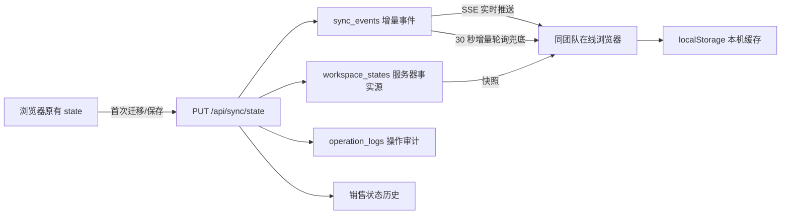

# 团队共享与数据同步实施说明

- 实施日期：2026-08-04
- 代码基线：`main` / `c0b2ec3`
- 固定团队编码：`operations-default`
- 固定团队名称：`运营团队`

## 1. 实施范围

本次仅升级数据层、权限层和同步层，不改动现有页面内容、布局、按钮、菜单、样式和客户字段，也不主动删除或覆盖任何现有业务数据。

现有一站式前端继续使用原有 `state`、`render()` 和交互逻辑。服务器新增团队工作空间状态作为共享事实源，浏览器 `localStorage['zhixun_one_stop_v1']` 保留为本机缓存和迁移备份。

## 2. 数据权限模型

### 2.1 固定团队

数据库初始化时幂等创建：

```text
团队名称：运营团队
团队编码：operations-default
```

已有用户会自动加入固定团队；新注册用户通过数据库触发器自动加入。首期角色支持：

- `owner`
- `admin`
- `member`
- `viewer`

`owner/admin/member` 可读写团队业务数据；`viewer` 只能读取。系统管理员权限仍由原用户 `role` 控制。

### 2.2 数据归属与审计

业务读取权限由 `team_id` 决定，但原 `user_id` 不删除：

- `team_id`：数据所属团队和读取边界
- `user_id`：原始归属/创建用户，兼容旧逻辑
- `created_by_user_id`：创建人
- `updated_by_user_id`：最后修改人
- `operator_user_id`：状态历史和操作日志中的实际操作人
- `version`：乐观锁版本
- `deleted_at/deleted_by_user_id`：软删除及删除操作人

## 3. 同步架构



### 3.1 同步接口

```text
GET  /api/sync/snapshot
GET  /api/sync/changes?cursor=<cursor>
GET  /api/sync/events?cursor=<cursor>&token=<jwt>
POST /api/sync/bootstrap
PUT  /api/sync/state
GET  /api/sync/status-history
```

### 3.2 同步时机

- 用户保存任何现有业务数据后异步写入服务器。
- SSE 立即通知同团队在线浏览器。
- 每 30 秒请求增量事件，作为 SSE 断线兜底。
- 浏览器重新获得焦点、页面重新可见或网络恢复时立即同步。
- 本地有待保存修改时，收到远端快照不会直接覆盖，而是执行三方合并后重新提交。

### 3.3 冲突与幂等

- 客户端提交 `baseVersion`。
- 服务器版本不一致时返回 HTTP `409` 和最新快照。
- 客户端对本机、共同基线和服务器状态执行三方合并，再用新版本提交。
- 写请求使用 `X-Request-Id`；同一团队内相同请求号返回已保存结果，不重复写入。

## 4. 销售状态同步（P0）

服务器在每次工作空间保存时比较保存前后的客户销售状态：

1. 识别新增客户的初始销售状态。
2. 识别已有客户的销售状态变化。
3. 将状态历史写回客户的 `statusHistory`。
4. 写入 `workspace_customer_status_history`。
5. 记录实际 `operator_user_id`、请求号、来源和同步事件号。
6. 生成 `customer.status_changed` 事件并通过 SSE 推送。

数据库唯一约束按团队、请求、客户和前后状态防重复，不会因为一个批次包含多个客户而漏记。

## 5. 数据保留与迁移

### 5.1 浏览器数据

首次连接尚未初始化的团队工作空间时，会先生成本地备份键：

```text
zhixun_one_stop_v1_pre_server_sync_<timestamp>
```

之后才把当前本地业务数据迁移到服务器。原 `zhixun_one_stop_v1` 继续保留为缓存，不执行删除。

### 5.2 服务器数据库

迁移采用 `CREATE TABLE IF NOT EXISTS`、字段存在性检查、`INSERT OR IGNORE` 和空字段回填，可重复执行。`workspace_states` 只在不存在时创建空记录，不重建、不清空已有团队状态。

资料删除改为软删除，磁盘原文件继续保留。

## 6. 部署步骤

### 6.1 部署前备份

必须先备份 SQLite 数据库，且不得覆盖旧备份：

```bash
mkdir -p /path/to/backups
sqlite3 /path/to/server/data/zhixun.db ".backup '/path/to/backups/zhixun-before-team-sync-$(date +%Y%m%d-%H%M%S).db'"
```

同时保留：

- `server/.env`
- `server/data/`
- 上传资料目录
- 浏览器 localStorage

### 6.2 同步代码

只同步代码文件，不覆盖：

```text
server/.env
server/data/
上传资料目录
```

不要运行 `/api/data/reset`，不要删除 `workspace_states`。

### 6.3 Nginx SSE 配置

SSE 路径需要关闭代理缓冲并延长读取超时：

```nginx
location /api/sync/events {
    proxy_pass http://127.0.0.1:3001;
    proxy_http_version 1.1;
    proxy_set_header Connection "";
    proxy_buffering off;
    proxy_cache off;
    proxy_read_timeout 1h;
    add_header X-Accel-Buffering no;
}
```

其他 `/api/` 路径保持原代理配置即可。

### 6.4 部署后检查

```bash
curl http://127.0.0.1:3001/api/health
sqlite3 /path/to/server/data/zhixun.db 'PRAGMA integrity_check;'
```

再检查：

1. 原客户数量未减少。
2. 原客户详情可正常打开。
3. 用户 A 修改销售状态，用户 B 在 3 秒内看到变化。
4. 刷新页面后状态仍存在。
5. 销售状态历史显示实际操作用户。
6. SSE 断开后，30 秒增量轮询能恢复数据。
7. `viewer` 可以查看但不能修改。

## 7. 自动化测试

隔离数据库测试命令：

```bash
cd server
npm run test:team-sync
```

测试覆盖：

- 固定团队和成员迁移
- 新用户自动加入团队
- 两用户共享同一工作空间
- 销售状态历史和操作人
- SSE 三秒内推送
- 增量接口兜底
- 请求幂等
- 409 乐观锁冲突
- 团队化业务接口
- 资料元数据共享和软删除
- `viewer` 只读权限
- SQLite `PRAGMA integrity_check`

## 8. 回滚

如部署后必须回滚：

1. 停止服务。
2. 备份当前故障现场数据库，便于排查。
3. 恢复部署前生成的 SQLite 备份。
4. 恢复部署前代码版本。
5. 保留浏览器中的 `zhixun_one_stop_v1` 和 `*_pre_server_sync_*` 备份键。
6. 重启服务并核对客户数量和数据库完整性。

禁止只回退代码而继续使用不兼容数据库，也禁止用空数据库覆盖现有数据库。
